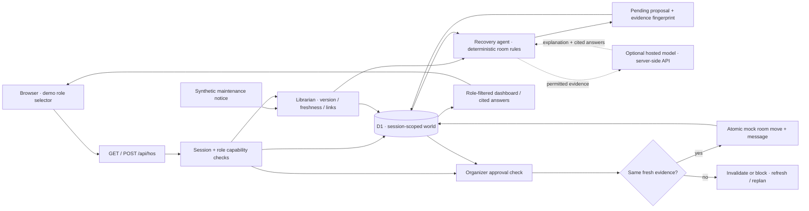

# H-OS · Campus Rescue architecture

Campus Rescue handles one synthetic event disruption: maintenance closes the Greenhouse, an agent proposes a suitable replacement, and an organizer approves the mock booking and message together.

**Brain and Librarian.** A browser session cookie selects a synthetic world in D1. The world contains the event, room inventory, versioned sources, proposal, and activity history. Sources carry visibility roles, timestamps, status, and version; seeded evidence expires after two hours of real time. Ingestion changes the evidence and refreshes the linked event state. Citations identify both a source and its version, so a reviewer can tell which evidence supported a proposal.

**Agent and model boundary.** Code checks capacity, accessibility, required equipment, availability, and relevant policy before proposing a room. Optional server-side model calls provide recovery explanations and cited Q&A from permitted evidence. The proposed attendee message is deterministic. A real local Anthropic `claude-sonnet-5-5` Q&A call was verified on 24 October 2026; Gemini/Gemma and OpenRouter offer an open-model path that still needs verification. Model output cannot grant permissions, make an ineligible room eligible, approve a proposal, or execute an action. Missing credentials or provider failure produces a labeled rules-only result.

**Approval and consistency.** A proposal records its evidence fingerprint and two draft actions. Approval requires the organizer demo role, a pending proposal, current evidence, and eligibility at execution time. A relevant update invalidates the old proposal; stale evidence blocks execution. Booking state, the public attendee message, and the executed-action record commit together. The API rejects an earlier proposal ID or repeated execution.

**Visibility and identity.** The server filters sources, operational activity, plans, and answers for the selected role. Organizers review recovery actions, facilities handles maintenance evidence, and attendees see public event information. The role selector intentionally impersonates these roles within the sandbox. It is not real authentication or membership verification. A hosted Sites access policy is a separate boundary and defaults to owner-private access.

**Operating scope.** Vinext/React runs on a Cloudflare Worker with D1 (`DB`). There is no real booking service, mail service, people monitoring, or H-FARM connector. The demo is action-triggered, not a durable autonomous scheduler. Synthetic state, model prompts, and responses should be treated as demonstration data. See the README for local setup and the demo guide for verification scenarios.
