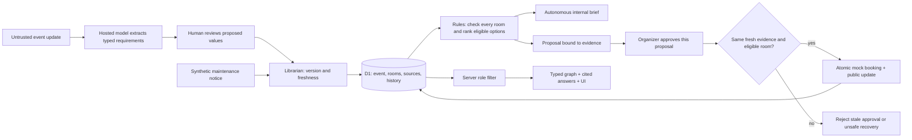

# H-OS · Campus Rescue architecture

One synthetic workflow: room disruption or changed requirements → updated Brain → autonomous internal recovery brief → organizer-approved mock relocation and publication. A printable one-page version is served at `/architecture.html`.

**Brain.** D1 stores an isolated synthetic world per browser session. Versioned sources carry role visibility, freshness and history. A deterministic typed graph projects event/room/requirement/proposal relationships with source citations; its actual link count drives the UI. It is a structured knowledge projection, not a general-purpose graph database or vector retrieval system.

**Librarian and model.** Maintenance and reviewed requirements create source versions. A hosted model interprets ordinary-language updates into bounded attendance/equipment values; extraction is read-only until an organizer reviews and applies it. The original notice remains internal evidence. Models also explain the prepared proposal and answer from fresh role-permitted sources. Invalid output is rejected; unavailable explanations and Q&A fall back visibly to rules. Interpretation fails visibly and offers structured controls. Citation validation proves envelope consistency, not semantic truth.

**Agent.** After relevant ingestion, code checks availability, capacity, step-free access and equipment for every room. Among eligible rooms it prefers the lowest synthetic energy estimate. It autonomously saves a versioned internal working brief. It cannot remove accessibility requirements or execute a booking or publication. No eligible room means a blocked recovery, not a weaker policy.

**Approval.** Each proposal records an evidence fingerprint. The organizer must approve its exact ID; fresh evidence, unchanged facts and room eligibility are rechecked. D1 compare-and-swap commits the two mock effects once. Updated facts invalidate previous approval. Three roles are filtered server-side; the role switch is deliberate demo impersonation, separate from hosted access.

**Runtime and scope.** React/Vinext → Cloudflare Worker → D1. Provider keys stay server-side. There are no H-FARM connectors, real room bookings, messages, invoices, people monitoring or persistent background scheduler. The loop runs when a source action arrives. MIT-licensed original source; synthetic dataset; provider/model provenance displayed per result.
